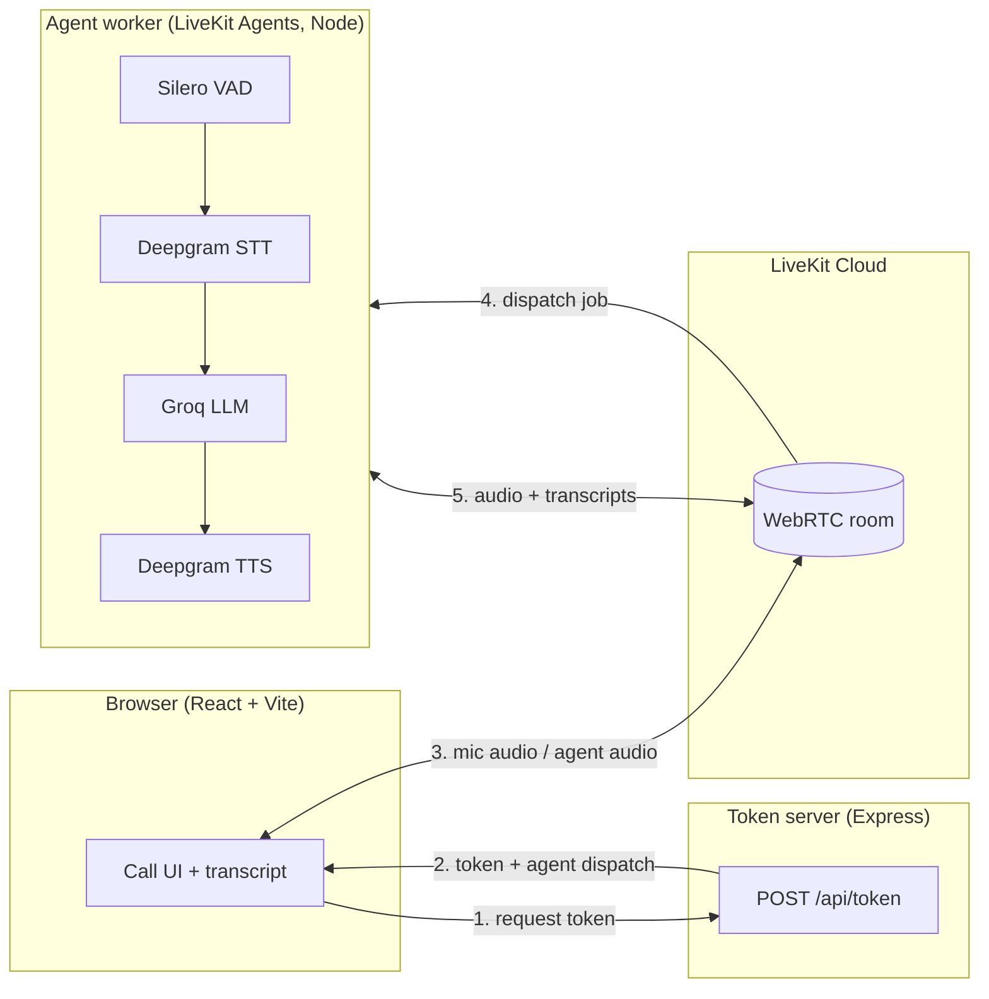

# Hello Po

**A real-time voice agent for customer service, running entirely on free tiers.**

Hello Po answers support calls for a fictional beach resort, _Isla Azul Beach Resort_. A caller opens the web app, clicks **Call support**, and talks to "Mara", a voice agent that listens, understands, and answers out loud in real time, with a live transcript on screen.

> "Hello po" is a polite Filipino greeting, the kind you would hear when calling a front desk in the Philippines.

|            |                                                                                                                                                                                                                                      |
| ---------- | ------------------------------------------------------------------------------------------------------------------------------------------------------------------------------------------------------------------------------------ |
| **Status** | Phase 3 (turn-taking) complete: interruptions stop in **199 ms p50, 201 ms max** (11 / 11 under 300 ms). Replies: **p50 411 ms / p95 968 ms**. See [measured performance](#measured-performance) and the [roadmap](docs/roadmap.md). |
| **Target** | Voice-to-voice reply p50 < 800 ms, interruption stop < 300 ms, $0 running cost                                                                                                                                                       |
| **Stack**  | TypeScript, LiveKit Agents (Node), Deepgram, Groq, React + Vite, Supabase                                                                                                                                                            |

---

## Table of contents

- [Features](#features)
- [How it works](#how-it-works)
- [Tech stack](#tech-stack)
- [Repository structure](#repository-structure)
- [Getting started](#getting-started)
  - [Prerequisites](#prerequisites)
  - [1. Create the provider accounts](#1-create-the-provider-accounts)
  - [2. Install](#2-install)
  - [3. Configure environment variables](#3-configure-environment-variables)
  - [4. Run locally](#4-run-locally)
  - [5. Make a test call](#5-make-a-test-call)
- [Scripts](#scripts)
- [Configuration reference](#configuration-reference)
- [Design decisions](#design-decisions)
- [Troubleshooting](#troubleshooting)
- [Security](#security)
- [Roadmap](#roadmap)
- [Documentation](#documentation)

---

## Features

### Available now (Phases 1–3)

- **Browser voice calls.** One click joins a private LiveKit room over WebRTC; no app install, no phone line.
- **Full speech pipeline.** Deepgram streaming speech-to-text, a Groq-hosted LLM, and Deepgram Aura-2 text-to-speech.
- **Agent greets first.** Mara answers the call and asks how she can help.
- **Live transcript.** Both sides of the conversation appear on screen as they are spoken.
- **Call state.** The UI shows whether the agent is connecting, listening, thinking, or speaking.
- **Grounded persona.** The agent only states the resort facts it was given and offers a staff follow-up for anything else.
- **Interrupt any time.** Talk over Mara and she goes quiet in about 200 ms. A cough or noise only pauses her for a moment before she carries on.
- **Per-turn latency.** A live table shows each stage of every reply (end of turn, LLM first token, TTS first audio), plus every interruption's stop time.
- **Call logging.** Calls, turns, and interruptions are saved to Supabase for reporting.
- **Swappable providers.** Each vendor (STT, LLM, TTS, VAD) is created in a single factory file, so replacing one is a one-file change.

### Planned

Latency waterfall chart, knowledge-base retrieval, booking and availability tools, support tickets, human handoff, sentiment tracking, a metrics dashboard, an automated eval suite, and a passcode-protected public demo. See the [roadmap](docs/roadmap.md).

---

## Measured performance

Voice-to-voice latency is the time from the caller's last word to the agent's first sound, measured by the agent for every turn. The Phase 2 acceptance run used three scripted calls (22 turns) against the deployed agent.

| Stage                                           | p50        | p95        | Budget |
| ----------------------------------------------- | ---------- | ---------- | ------ |
| **Voice to voice (total)**                      | **450 ms** | **945 ms** | 800 ms |
| End of turn (after the Flux end-of-turn signal) | 1 ms       | 3 ms       | 200 ms |
| LLM first token (Groq)                          | 177 ms     | 723 ms     | 200 ms |
| TTS first audio (Deepgram)                      | 201 ms     | 244 ms     | 150 ms |

How the numbers came down:

| Configuration                              | p50        | p95        | Turns |
| ------------------------------------------ | ---------- | ---------- | ----- |
| Local agent, SDK defaults, Nova-3          | ~3,100 ms  | ~6,300 ms  | 4     |
| Local agent, tuned turn-taking, Nova-3     | ~1,500 ms  | ~1,850 ms  | 3     |
| Local agent, Deepgram Flux                 | 1,362 ms   | 1,903 ms   | 8     |
| **Agent on LiveKit Cloud (us-east), Flux** | **450 ms** | **945 ms** | 22    |

Raw data: [`docs/results/phase-2-cloud-latency.log`](docs/results/phase-2-cloud-latency.log). Reproduce the summary with:

```bash
npm run latency:report -- --lines docs/results/phase-2-cloud-latency.log
```

> The total is measured on the agent. Audio travelling between the caller and the agent's region adds network time on top, which is not yet measured end to end.

### Interruptions

Stop time is the time from the caller talking over the agent to the agent's audio pausing, measured on the agent. The Phase 3 acceptance run used three calls against the deployed agent.

| Configuration                                           | Interruptions | p50        | Max        | Under 300 ms |
| ------------------------------------------------------- | ------------- | ---------- | ---------- | ------------ |
| Wait for one transcribed word (`minWords: 1`)           | 9             | 947 ms     | 2,623 ms   | 0 / 9        |
| **Local VAD decides (`mode: 'vad'`, 200 ms of speech)** | **11**        | **199 ms** | **201 ms** | **11 / 11**  |

The same calls measured voice-to-voice p50 411 ms and p95 968 ms over 21 turns. Full write-up and raw data: [`docs/results/phase-3-interruptions.md`](docs/results/phase-3-interruptions.md). Reproduce with:

```bash
npm run latency:report -- --since 2026-11-23T19:40 --last 100
```

---

## How it works



1. The browser asks the **token server** for credentials.
2. The token server creates a unique room name, signs a short-lived LiveKit access token, and embeds an **agent dispatch** for `hello-po-agent` in the token's room configuration.
3. The browser joins the room and publishes the caller's microphone.
4. LiveKit Cloud sees the dispatch and sends a job to the registered **agent worker**.
5. The agent joins the same room, greets the caller, and runs the pipeline for every turn:
   **VAD → speech-to-text → LLM → text-to-speech**, all streaming. Transcripts are published back to the room and rendered in the browser.

A deeper walkthrough, including the call lifecycle and event formats, is in [docs/architecture.md](docs/architecture.md).

---

## Tech stack

| Layer          | Choice                                                            | Why                                                                                                          |
| -------------- | ----------------------------------------------------------------- | ------------------------------------------------------------------------------------------------------------ |
| Language       | TypeScript (Node 24+)                                             | One language across agent, server, and UI. The LiveKit Agents Node SDK requires Node 24.                     |
| Monorepo       | npm workspaces                                                    | Shared types between apps with no extra tooling.                                                             |
| Agent runtime  | [LiveKit Agents](https://docs.livekit.io/agents/) Node SDK `1.10` | Handles the realtime audio pipeline, turn-taking, and room I/O.                                              |
| Transport      | LiveKit Cloud (WebRTC)                                            | Low-latency audio with a global edge network and a free Build plan.                                          |
| Speech-to-text | Deepgram Flux (`flux-general-en`, streaming)                      | Built for voice agents: detects end of turn from meaning and silence. Measured faster than Nova-3 here.      |
| LLM            | Groq `qwen/qwen3.8-27b`                                           | Groq's inference is very fast; Qwen3 with reasoning disabled gave the steadiest first-token time in testing. |
| Text-to-speech | Deepgram Aura-2 (`aura-2-asteria-en`)                             | Low time-to-first-audio, natural voice.                                                                      |
| Voice activity | Silero VAD                                                        | Local, lightweight detection of when the caller is speaking.                                                 |
| Frontend       | React 19, Vite 8, Tailwind CSS 4, `@livekit/components-react`     | Official hooks for sessions, agent state, and transcripts.                                                   |
| Token server   | Express 5 + `livekit-server-sdk`                                  | Keeps API secrets on the server; mints tokens per call.                                                      |
| Database       | Supabase (Postgres)                                               | Call logs, turn timings, and eval results (from Phase 2).                                                    |

---

## Repository structure

```
hello-po/
├── apps/
│   ├── agent/                # LiveKit Agents worker
│   │   └── src/
│   │       ├── main.ts       # Worker entry: prewarm, session setup, greeting
│   │       ├── providers.ts  # STT / LLM / TTS / VAD factories (swap vendors here)
│   │       ├── prompt.ts     # Agent persona, rules, greeting, STT key terms
│   │       ├── latency.ts    # Per-turn latency from the SDK's message metrics
│   │       ├── events.ts     # Publishes events to the browser (data channel)
│   │       ├── db.ts         # Supabase call and turn logging
│   │       ├── turn-log.ts   # Local logs/turns.jsonl fallback
│   │       └── config.ts     # Loads .env and exposes typed config
│   ├── token-server/         # Express endpoint that mints LiveKit tokens
│   │   └── src/index.ts
│   └── web/                  # React + Vite frontend
│       ├── index.html
│       ├── vite.config.ts    # Dev proxy: /api -> token server
│       └── src/
│           ├── App.tsx       # Call button, agent state, live transcript
│           ├── LatencyPanel.tsx  # Live per-turn latency table
│           ├── main.tsx
│           └── index.css
├── packages/
│   └── shared/               # Types and constants shared by all apps
│       └── src/index.ts      # Data-channel event types, agent name
├── docs/
│   ├── architecture.md       # System design and call lifecycle
│   ├── roadmap.md            # Phases and acceptance criteria
│   └── results/              # Raw measurement data from acceptance runs
├── scripts/
│   └── latency-report.ts     # p50 / p95 latency summary
├── supabase/
│   └── migrations/           # SQL schema: calls, turns, interruptions
├── Dockerfile                # Agent image for LiveKit Cloud
├── livekit.toml              # LiveKit Cloud agent id (created by the CLI)
├── .env.example              # Every environment variable, documented
├── eslint.config.mjs
├── tsconfig.base.json
└── package.json              # Workspace root and scripts
```

---

## Getting started

### Prerequisites

| Requirement                      | Version                                 | Check                                   |
| -------------------------------- | --------------------------------------- | --------------------------------------- |
| Node.js                          | 24 or newer                             | `node -v`                               |
| npm                              | 10 or newer (ships with Node)           | `npm -v`                                |
| A browser with microphone access | Chrome, Edge, Brave, Firefox, or Safari |                                         |
| Free RAM                         | ~1.5 GB available while running         | See [Troubleshooting](#troubleshooting) |

### 1. Create the provider accounts

All providers have free tiers. **Do not add a credit card** to any of them: without one, exceeding a quota fails safely instead of billing you.

| Provider          | Sign up                                              | What you need                                                                                                                                                                                                                  |
| ----------------- | ---------------------------------------------------- | ------------------------------------------------------------------------------------------------------------------------------------------------------------------------------------------------------------------------------ |
| **LiveKit Cloud** | [cloud.livekit.io](https://cloud.livekit.io)         | Create a project, then open **Manage API keys** on the project overview. Copy the WebSocket URL (`wss://…livekit.cloud`), the API key (`API…`), and the API secret (a ~44 character string, **not** a generated `eyJ…` token). |
| **Deepgram**      | [console.deepgram.com](https://console.deepgram.com) | **API Keys → Create key.** One key covers both speech-to-text and text-to-speech.                                                                                                                                              |
| **Groq**          | [console.groq.com](https://console.groq.com)         | **API Keys → Create key** (starts with `gsk_`).                                                                                                                                                                                |
| **Supabase**      | [supabase.com](https://supabase.com)                 | New project, then **Project Settings → API Keys**. Copy the Project URL and a **secret key** (`sb_secret_…`). Then run each file in `supabase/migrations/` in order in the **SQL editor**.                                     |

### 2. Install

```bash
git clone https://github.com/csjames03/hello-po.git
cd hello-po
npm install
```

The agent depends on native speech packages (`onnxruntime-node`, about 85 MB, and LiveKit's local inference runtime, about 95 MB). The repo's `.npmrc` raises npm's fetch timeout so these finish on slower connections.

### 3. Configure environment variables

```bash
cp .env.example .env      # Windows (cmd): copy .env.example .env
```

Open `.env` and fill in:

```dotenv
LIVEKIT_URL=wss://your-project.livekit.cloud
LIVEKIT_API_KEY=APIxxxxxxxxxxxx
LIVEKIT_API_SECRET=xxxxxxxxxxxxxxxxxxxxxxxxxxxxxxxxxxxxxxxxxxxx
DEEPGRAM_API_KEY=xxxxxxxxxxxxxxxxxxxxxxxxxxxxxxxxxxxxxxxx
GROQ_API_KEY=gsk_xxxxxxxxxxxxxxxxxxxxxxxxxxxxxxxxxxxxxxxxxxxxxxxxxxxx
```

All apps read the single `.env` file at the repo root. It is git-ignored; never commit it.

### 4. Run locally

Start the three apps in three terminals, from the repo root:

```bash
npm run dev:token   # token server on http://localhost:3001
npm run dev:agent   # agent worker, registers with LiveKit Cloud
npm run dev:web     # web app on http://localhost:5173
```

When the agent is ready, its log shows:

```
INFO: registered worker
    agentName: "hello-po-agent"
```

### 5. Make a test call

1. Open **http://localhost:5173**.
2. Click **Call support** and allow microphone access.
3. Mara greets you within a few seconds. Try:
   - _"What time is check-in?"_
   - _"Do you have a spa? When is it open?"_
   - _"What's your cancellation policy?"_
   - _"How much is a room per night?"_ (She should say she doesn't have that information and offer a follow-up, rather than invent a price.)
4. Click **Hang up** to end the call.

---

## Scripts

Run from the repo root.

| Command                  | Description                                                                                                            |
| ------------------------ | ---------------------------------------------------------------------------------------------------------------------- |
| `npm run dev:agent`      | Start the agent worker in development mode                                                                             |
| `npm run dev:token`      | Start the token server with file watching                                                                              |
| `npm run dev:web`        | Start the Vite dev server                                                                                              |
| `npm run typecheck`      | Type-check every workspace                                                                                             |
| `npm run lint`           | Lint the whole repo with ESLint                                                                                        |
| `npm run format`         | Format the whole repo with Prettier                                                                                    |
| `npm run format:check`   | Check formatting without writing                                                                                       |
| `npm run latency:report` | Print p50 / p95 latency per stage and interruption stop times (`--since TIME`, `--local`, `--lines FILE`, or Supabase) |

TypeScript runs directly on Node 24 through native type stripping, so the agent and token server have no build step in development.

---

## Configuration reference

All variables live in `.env` at the repo root. See [`.env.example`](.env.example) for the annotated template.

### Required

| Variable             | Used by             | Description                   |
| -------------------- | ------------------- | ----------------------------- |
| `LIVEKIT_URL`        | token server, agent | LiveKit project WebSocket URL |
| `LIVEKIT_API_KEY`    | token server, agent | LiveKit API key               |
| `LIVEKIT_API_SECRET` | token server, agent | LiveKit API secret            |
| `DEEPGRAM_API_KEY`   | agent               | Deepgram key for STT and TTS  |
| `GROQ_API_KEY`       | agent               | Groq key for the LLM          |

### Used in later phases

| Variable              | Description                                                         |
| --------------------- | ------------------------------------------------------------------- |
| `SUPABASE_URL`        | Supabase project URL                                                |
| `SUPABASE_SECRET_KEY` | Supabase secret key (server-side only; bypasses row-level security) |
| `DEMO_PASSCODE`       | Passcode required before a public visitor can start a call          |
| `DEMO_PAUSED`         | `true` blocks new calls (kill switch)                               |
| `MAX_SESSION_SECONDS` | Hard limit per call, default `120`                                  |

### Optional overrides

| Variable            | Default             | Description                                                     |
| ------------------- | ------------------- | --------------------------------------------------------------- |
| `LLM_MODEL`         | `qwen/qwen3.8-27b`  | Any Groq chat model id                                          |
| `STT_MODEL`         | `flux-general-en`   | Deepgram speech-to-text model (`flux-general-en` or `nova-3`)   |
| `TTS_VOICE`         | `aura-2-asteria-en` | Deepgram Aura voice                                             |
| `TOKEN_SERVER_PORT` | `3001`              | Token server port (update `apps/web/vite.config.ts` if changed) |

---

## Design decisions

**Groq with Qwen3 instead of Llama.** Groq no longer serves Llama chat models. Of the chat models it offers, `qwen/qwen3.8-27b` with `reasoning_effort: "none"` had the most consistent time-to-first-token in streaming tests (about 260–310 ms from the Philippines, network included). `openai/gpt-oss-20b` was sometimes faster but varied from about 220 to 750 ms because it reasons silently before answering, which hurts p95. The model id is a single config value, so it can be swapped.

**The OpenAI plugin pointed at Groq.** Groq exposes an OpenAI-compatible API. The agent uses the LiveKit OpenAI plugin with Groq's base URL, rather than the `withGroq` helper, because the helper does not expose `reasoningEffort`, which Qwen3 needs to skip its thinking step.

**Direct provider keys instead of LiveKit Inference.** LiveKit offers a hosted model gateway billed against LiveKit credits. Calling Deepgram and Groq directly keeps every provider on its own free tier and makes each one independently replaceable.

**Explicit agent dispatch.** The worker registers under a fixed name (`hello-po-agent`), and the token server embeds a dispatch for that name in each token. The agent only joins rooms created by this app, never stray rooms in the same LiveKit project.

**Deepgram Flux for end-of-turn detection.** Flux decides when the caller has finished from both meaning and silence, and sends an early "probably done" signal that lets the LLM start before the turn is confirmed. With Flux the agent adds no extra wait after the end-of-turn signal. It beat Nova-3 with silence-based endpointing in side-by-side calls, and avoids loading the LiveKit turn-detector model, which holds about 450 MB of weights in memory.

**Barge-in decided by the local VAD.** Requiring one transcribed word before stopping (`minWords: 1`) made the agent wait on a speech-to-text round trip, and stops took 0.5 to 2.6 seconds. The agent now pauses after 200 ms of speech detected by the local Silero VAD (raised threshold, so breathing and room noise don't count). If no words follow, it resumes after one second. LiveKit's cloud "adaptive" interruption model was skipped because it adds another network hop before the agent can stop.

**Stricter end-of-turn.** Flux's end-of-turn threshold is 0.8 instead of 0.7, because short pauses ("Wait. … describe the restaurant") ended the caller's turn and the agent started replying over them.

**Agent hosted next to its providers.** Deepgram serves from the US, about 250 ms round trip from the Philippines. Running the agent on LiveKit Cloud in `us-east` cut those round trips to a few milliseconds and brought the p50 from 1,362 ms to 450 ms, even though caller audio now travels further.

**Fixed greeting, capped replies.** The greeting is spoken verbatim with `session.say()` instead of being generated, because Qwen's chat template rejects a request with no user message. Replies are capped at 150 tokens, because Groq's free tier budgets each request at its maximum output length against a per-minute output limit.

**Standard token endpoint format.** The token server returns LiveKit's standard response shape (`server_url`, `participant_token`), so the frontend uses the official `TokenSource.endpoint()` and `useSession()` APIs instead of custom connection code.

---

## Deploying the agent

The agent runs on LiveKit Cloud (free Build plan: one deployment, five concurrent sessions, 1,000 agent minutes a month, no card). The image is built from the repo-root `Dockerfile`, which installs only the agent workspace.

```bash
# One-time: register the project with the CLI using the keys from .env
lk project add hello-po --url "$LIVEKIT_URL" --api-key "$LIVEKIT_API_KEY" --api-secret "$LIVEKIT_API_SECRET" --default

# First deploy (the region cannot be changed later). Secrets must not include LIVEKIT_* keys.
lk agent create --region us-east --secrets-file agent-secrets.env .

# Later deploys, status and logs
lk agent deploy .
lk agent status
lk agent logs
```

On the Build plan the agent scales to zero when idle, so the first call after a quiet period takes 10 to 20 seconds to connect. Stop any locally running agent while testing the deployed one: both register under the same name, and LiveKit dispatches calls to either.

---

## Troubleshooting

<details>
<summary><strong>The UI says "Agent could not join" or the agent state is <code>failed</code></strong></summary>

The agent did not join the room within 30 seconds. Check the agent terminal:

- **`event loop blocked` warnings, or long gaps between log lines.** The machine is short on memory or CPU. Close heavy applications (browser tabs especially) and try again. On Windows, check free memory with Task Manager → Performance → Memory.
- **`worker ping timed out` or `failed to connect to LiveKit server`.** A network interruption between the worker and LiveKit Cloud. The worker retries automatically; wait for `registered worker` and call again.
- **The agent never logs `received job request`.** Make sure the agent is running and that `.env` points to the same LiveKit project as the token server (they share one `.env`, so this usually means the agent was started before `.env` was filled in; restart it).

</details>

<details>
<summary><strong><code>401 invalid token</code> or authentication errors from LiveKit</strong></summary>

`LIVEKIT_API_SECRET` is wrong. The most common mistake is pasting a generated access token (a long string starting with `eyJ`) instead of the API secret (about 44 characters). Create a new key pair in the LiveKit dashboard and copy the secret when it is shown.

</details>

<details>
<summary><strong><code>npm install</code> fails with a timeout</strong></summary>

The native speech packages are large. The repo's `.npmrc` already allows 30 minutes per download with 5 retries. Re-running `npm install` resumes with the packages that finished. If your network is unstable, retry on a steadier connection.

</details>

<details>
<summary><strong>No sound from the agent</strong></summary>

Browsers only allow audio playback after a user gesture. Clicking **Call support** counts as one, so audio should start. Check that the tab is not muted and that the correct output device is selected. If the transcript shows agent replies but there is no sound, the problem is local audio output, not the agent.

</details>

<details>
<summary><strong>The agent hears itself, or cuts itself off</strong></summary>

Use headphones. Without them, the agent's voice can reach your microphone, and because barge-in reacts to 200 ms of speech, the agent can pause on its own echo. LiveKit's browser echo cancellation helps but is not perfect on laptop speakers.

</details>

---

## Security

- **Secrets stay on the server.** API keys live only in `.env`, read by the token server and the agent. The browser receives a short-lived (10 minute) LiveKit token scoped to a single room.
- **`.env` is git-ignored.** `.env.example` documents every variable without values.
- **One room per call.** Each call gets a random room name, so callers never share a room.
- **No card on file.** Every provider runs on a free tier without a payment method, so quota overruns fail rather than bill.
- **Public demo guardrails (Phase 6):** passcode gate, per-IP daily call limit, concurrent call cap, two-minute session limit, and a pause switch.

---

## Roadmap

| Phase | Focus                                                                          | Status  |
| ----- | ------------------------------------------------------------------------------ | ------- |
| 1     | **MVP:** working browser voice call with a live transcript                     | Done    |
| 2     | **Latency:** per-stage timing, Supabase logging, p50 < 1 s                     | Done    |
| 3     | **Turn-taking:** barge-in, VAD and turn-detector tuning, stop < 300 ms         | Done    |
| 4     | **Brain:** knowledge base, tools, handoff rules, sentiment                     | Next    |
| 5     | **UI and evals:** latency waterfall, sentiment panel, metrics page, eval suite | Planned |
| 6     | **Ship:** deploy, cost guardrails, case study                                  | Planned |

Details and acceptance criteria for each phase are in [docs/roadmap.md](docs/roadmap.md).

---

## Documentation

- [Architecture](docs/architecture.md): components, call lifecycle, event formats, latency budget
- [Roadmap](docs/roadmap.md): phases, scope, and acceptance criteria
- [`.env.example`](.env.example): annotated environment variables

---

## Acknowledgements

Built on [LiveKit Agents](https://github.com/livekit/agents-js), [Deepgram](https://deepgram.com), [Groq](https://groq.com), and [Supabase](https://supabase.com). Isla Azul Beach Resort is fictional; any resemblance to a real business is coincidental.
