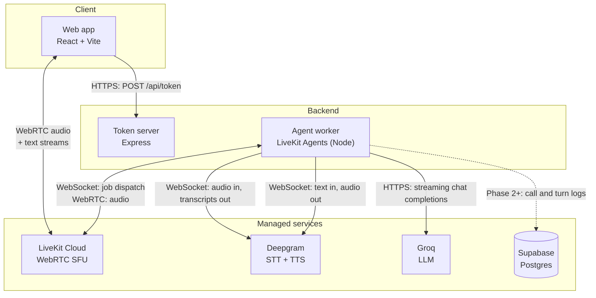
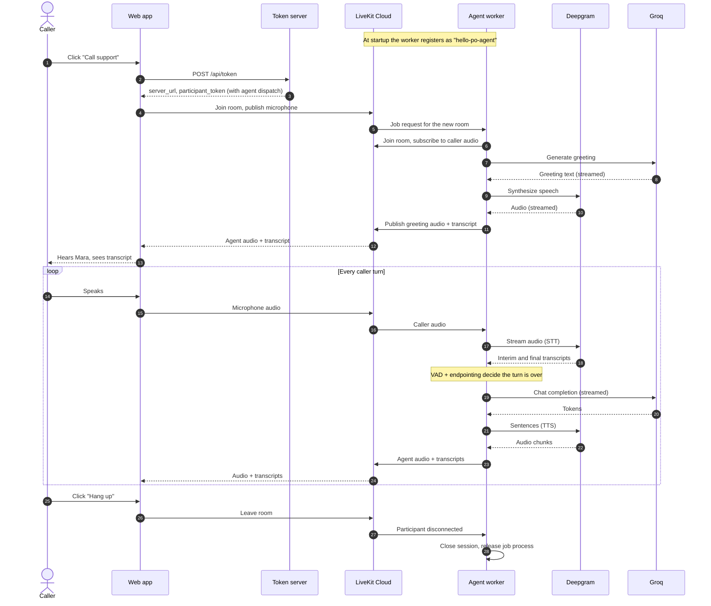
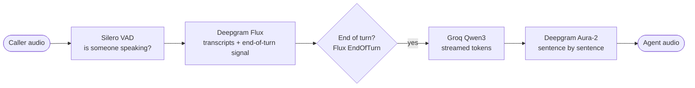
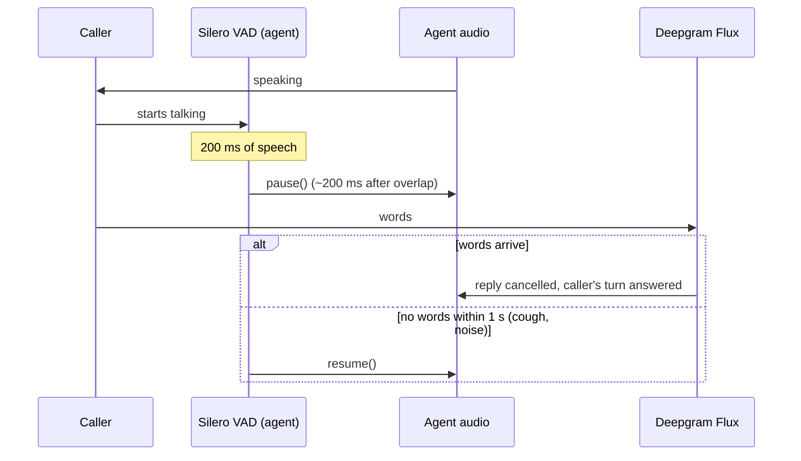

# Architecture

This document describes how Hello Po is put together: the components, how a call flows through them, the data exchanged between them, and the latency budget the design is built around.

- [System overview](#system-overview)
- [Components](#components)
- [Call lifecycle](#call-lifecycle)
- [The voice pipeline](#the-voice-pipeline)
- [Provider abstraction](#provider-abstraction)
- [Data channel events](#data-channel-events)
- [Latency budget](#latency-budget)
- [Configuration and secrets](#configuration-and-secrets)
- [Deployment topology](#deployment-topology)

---

## System overview



Hello Po is three small applications plus four managed services. The browser never talks to Deepgram, Groq, or Supabase directly. It only talks to the token server (once, to get credentials) and to LiveKit (for the duration of the call). All provider keys stay on the backend.

---

## Components

### Web app (`apps/web`)

A single-page React app served by Vite.

| Responsibility        | Implementation                                                                      |
| --------------------- | ----------------------------------------------------------------------------------- |
| Fetch credentials     | `TokenSource.endpoint('/api/token')` from `livekit-client`                          |
| Manage the connection | `useSession()` and `SessionProvider` from `@livekit/components-react`               |
| Show agent state      | `useAgent()`: `connecting`, `listening`, `thinking`, `speaking`, `failed`           |
| Show the transcript   | `useSessionMessages()`, filtered to `userTranscript` and `agentTranscript` messages |
| Play agent audio      | `<RoomAudioRenderer />`                                                             |

In development, Vite proxies `/api/*` to the token server on port 3001, so the browser makes same-origin requests and no CORS configuration is needed.

### Token server (`apps/token-server`)

A single Express route, `POST /api/token`. For each request it:

1. Generates a random room name (`call-xxxxxxxx`) and caller identity (`caller-xxxxxxxx`).
2. Creates an `AccessToken` valid for 10 minutes, with grants to join only that room and to publish and subscribe.
3. Sets the token's `roomConfig` to dispatch the agent named `hello-po-agent` when the room is created.
4. Returns LiveKit's standard token endpoint response:

```json
{
  "server_url": "wss://your-project.livekit.cloud",
  "participant_token": "eyJhbGciOi...",
  "room_name": "call-1a2b3c4d"
}
```

The request body is ignored on purpose. The server decides the room name and which agent joins, so a client cannot request a different agent or join someone else's room.

### Agent worker (`apps/agent`)

A long-running Node process built on the LiveKit Agents SDK.

| File           | Responsibility                                                                                                          |
| -------------- | ----------------------------------------------------------------------------------------------------------------------- |
| `main.ts`      | Defines the agent (`defineAgent`), registers the worker with LiveKit Cloud under `hello-po-agent`, and handles each job |
| `providers.ts` | Factories for STT, LLM, TTS, and VAD; the only file that imports provider plugins                                       |
| `prompt.ts`    | The persona, speaking rules, resort facts, and greeting instruction                                                     |
| `config.ts`    | Loads the root `.env`, validates required keys, and exposes typed settings                                              |

The worker keeps a pool of idle job processes. Each process runs `prewarm` once, loading the Silero VAD model, so a new call doesn't pay the model-loading cost. In development the pool size is `1` to keep memory use low.

### Shared package (`packages/shared`)

Types and constants imported by both the agent and the web app, so the two sides can't drift apart:

- `AGENT_NAME`: the dispatch name used by the token server and the worker
- `EVENTS_TOPIC`: the data channel topic for Hello Po events
- Event types: `TranscriptEvent`, `SentimentEvent`, `LatencyEvent`, `InterruptEvent`, `ToolEvent`, `HandoffEvent`

---

## Call lifecycle



If the agent doesn't join within 30 seconds, the web app marks the agent as `failed` and asks the caller to hang up and retry.

On a cold start LiveKit can dispatch a second job to the same room. Each agent checks for other agents right after joining; if one with a lower identity is already there, it leaves. Exactly one agent stays in the call.

---

## The voice pipeline



Every stage streams, so later stages start before earlier ones finish:

- **STT** sends interim transcripts while the caller is still speaking.
- **Turn detection** is STT-based (`turnDetection: 'stt'`). Flux ends the turn when its end-of-turn confidence reaches 0.8, and sends an earlier "probably done" signal at 0.5.
- **Preemptive generation** is enabled by the SDK: the LLM request can start on a near-final transcript, before the turn is formally committed.
- **LLM** output streams token by token. Qwen3 runs with `reasoning_effort: "none"` so it answers immediately instead of thinking first.
- **TTS** starts synthesizing as soon as the first full sentence arrives from the LLM, rather than waiting for the whole reply.

### Interruptions (barge-in)



- Barge-in is decided by the local VAD (`interruption.mode: 'vad'`, `minWords: 0`, `minDuration: 200`), not by the transcript. Waiting for a transcribed word took 0.5–2.6 s because of the speech-to-text round trip.
- Interruptions are disabled for the first 3 s of a call while echo cancellation warms up.
- `apps/agent/src/interruptions.ts` measures each stop from the audio output's `pause()` / `clearBuffer()` calls and publishes an `interrupt` event. Results: [`results/phase-3-interruptions.md`](results/phase-3-interruptions.md).

---

## Provider abstraction

Every external model is created in `apps/agent/src/providers.ts`:

```ts
export function createStt() {
  /* Deepgram STT */
}
export function createLlm() {
  /* Groq via the OpenAI-compatible plugin */
}
export function createTts() {
  /* Deepgram TTS */
}
export function loadVad() {
  /* Silero VAD */
}
```

`main.ts` only calls these factories. To switch a provider, for example Deepgram TTS to another vendor, edit one function in `providers.ts` and add the new plugin. Nothing else changes.

---

## Data channel events

Beyond LiveKit's built-in transcripts, the agent publishes structured events (`latency` and `interrupt` so far) on the topic `hello-po.events`. The types live in `packages/shared/src/index.ts`. Each event has a `type` discriminator.

| Event        | Fields                                                                      | Purpose                                            | Phase |
| ------------ | --------------------------------------------------------------------------- | -------------------------------------------------- | ----- |
| `transcript` | `turnId`, `speaker` (`user` \| `agent`), `text`, `final`, `ts`              | Speaker-labelled transcript with turn ids          | 5     |
| `latency`    | `turnId`, `eotMs`, `sttMs`, `llmFirstTokenMs`, `ttsFirstAudioMs`, `totalMs` | Per-turn latency waterfall                         | 2     |
| `interrupt`  | `turnId`, `stopMs`                                                          | How quickly the agent went silent after a barge-in | 3     |
| `sentiment`  | `turnId`, `score` (-1..1), `label`                                          | Caller sentiment per turn                          | 4     |
| `tool`       | `turnId`, `name`, `args`, `ok`                                              | Tool calls made by the agent                       | 4     |
| `handoff`    | `ticketId`, `reason`                                                        | Escalation to a human, with the created ticket     | 4     |

In Phase 1 the transcript shown in the UI comes from LiveKit's built-in transcription streams. The custom events are defined now so both sides share one contract as features land.

---

## Latency budget

The target is a voice-to-voice reply, from the moment the caller stops speaking to the moment they hear the agent, under **800 ms at p50** and **1,200 ms at p95**.

| Stage                 | Budget     | Measured from → to                               |
| --------------------- | ---------- | ------------------------------------------------ |
| End-of-turn detection | 200 ms     | Caller stops speaking → turn committed           |
| STT final transcript  | 150 ms     | Turn committed → final transcript available      |
| LLM first token       | 200 ms     | Request sent → first token received              |
| TTS first audio       | 150 ms     | First sentence sent → first audio chunk received |
| Network and transport | 100 ms     | Agent ↔ LiveKit ↔ browser                        |
| **Total p50**         | **800 ms** |                                                  |

Phase 2 adds a timestamp at each stage boundary, emits `latency` events, and stores them in Supabase so p50 and p95 can be computed over real calls.

Measured in the Phase 2 acceptance run (22 turns, agent on LiveKit Cloud `us-east`):

| Stage                  | p50    | p95    | Budget |
| ---------------------- | ------ | ------ | ------ |
| Voice to voice (total) | 450 ms | 945 ms | 800 ms |
| End of turn            | 1 ms   | 3 ms   | 200 ms |
| LLM first token        | 177 ms | 723 ms | 200 ms |
| TTS first audio        | 201 ms | 244 ms | 150 ms |

Measurement notes:

- Values come from the SDK's per-message metrics: `e2eLatency` (user stopped speaking to agent started speaking), `endOfTurnDelay`, `transcriptionDelay`, `llmNodeTtft` and `ttsNodeTtfb`. They are emitted as `latency` events, printed as `[latency]` log lines, and stored in Supabase when configured.
- Stages overlap: the LLM can start on Flux's early end-of-turn signal, so stage values need not sum to the total.
- The total is measured at the agent. Network time between the caller and the agent's region is not included.
- The largest remaining variance is Groq's first-token time on the free tier (one turn took 3.7 s).

---

## Configuration and secrets

- One `.env` file at the repo root is read by the token server and the agent through `dotenv`.
- `config.ts` fails fast with a clear message if a required key is missing.
- The browser bundle contains no secrets. Its only credential is the per-call LiveKit token.
- `LIVEKIT_AGENTS_PRELOAD_LOCAL_INFERENCE=0` is set by default, so the worker doesn't load the ~450 MB local turn-detector model, which Phase 1 doesn't use.

---

## Deployment topology

Planned for Phase 6:

| Component    | Host                                  | Notes                                                     |
| ------------ | ------------------------------------- | --------------------------------------------------------- |
| Web app      | Vercel                                | Static build of `apps/web`                                |
| Token server | Vercel serverless function            | Same `/api/token` contract, plus passcode and rate limits |
| Agent worker | LiveKit Cloud (Build plan), `us-east` | Deployed with the LiveKit CLI since Phase 2               |
| Database     | Supabase (free tier)                  | Call logs, turn timings, eval results                     |

Locally, all three apps run on the developer's machine and connect to the same managed services.
